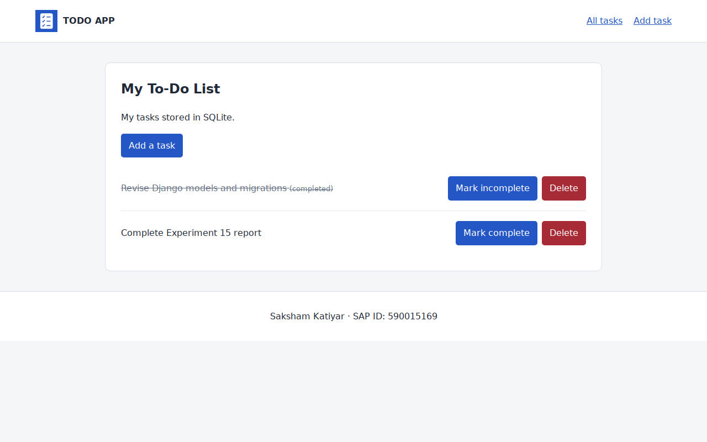

# Experiment 15: Django To-Do Application

**Name:** Saksham Katiyar  
**SAP ID:** 590015169  
**Date:** 27 October 2026

## Objective

To build a Django To-Do app with SQLite and demonstrate CRUD, Django Admin, reusable templates and static assets. Both lab manuals are implemented in one project.

## Tools Used

- Python and Django 5.2.18
- SQLite
- HTML, CSS and JavaScript

## Procedure

1. Created the Django project `todo_project` and the app `todo`.
2. Added the Task model with title, completion status and creation time.
3. Created and applied the database migration.
4. Connected the list, add, toggle and delete views with named URL routes.
5. Used POST forms and CSRF tokens for creating, toggling and deleting tasks.
6. Added a shared base, header and footer. Both pages extend the base template.
7. Loaded CSS, JavaScript and the logo from `todo/static/todo/`.
8. Used a page-specific JavaScript block to focus the task input.
9. Registered Task in Admin with list display, completion filter and title search.
10. Checked the model, views, validation, CSRF handling and templates using Django tests.

## Main Concepts

- Model defines stored data; view handles the request; template produces the HTML.
- `makemigrations` writes schema changes; `migrate` applies them to SQLite.
- `admin.py` registers and displays models in Admin. `apps.py` configures the application.
- `extends` shares a whole layout. `include` inserts a reusable part such as the footer.
- Task creation time is generated on the server by `auto_now_add=True`.

## Output and Verification

- `python manage.py check`: no issues.
- `python manage.py makemigrations --check --dry-run`: no changes detected.
- `python manage.py test`: 10 tests passed, including CRUD, validation, CSRF, POST-only changes, 404 responses, template reuse and Admin configuration.

- Browser checks passed for add/list/toggle/delete, static CSS/JS/logo loading, input focus and the admin task list. No page script errors were recorded.
- Checked a 390-pixel mobile layout with no horizontal overflow.
- Stopped and restarted the development server; the same sample tasks and completion state remained in SQLite.
- Screenshots below use sample tasks and a temporary local review account. The database, sessions and account are not committed.

## Screenshots

| Page | Evidence |
|---|---|
| Home | [home.png](screenshots/home.png) |
| Add Task | [add-task.png](screenshots/add-task.png) |
| Django Admin | [admin.png](screenshots/admin.png) |
| Mobile home | [mobile.png](screenshots/mobile.png) |

## Result

The basic CRUD application and the v2 extensions are implemented in the same `LAB/Exp15` folder. Tasks are stored through Django's ORM in SQLite. The shared footer shows Saksham Katiyar and SAP ID 590015169.

## Conclusion

Django connects URL routes, views, models and templates to handle requests. Template inheritance avoids repeated HTML, and static files keep styling and JavaScript separate from the page templates.
